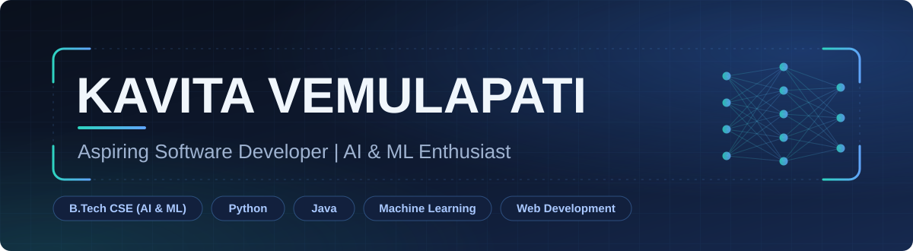

 

 

[About](#about-me) &nbsp;•&nbsp; [Skills](#technical-skills) &nbsp;•&nbsp; [Projects](#featured-projects) &nbsp;•&nbsp; [Experience](#experience) &nbsp;•&nbsp; [Stats](#github-statistics) &nbsp;•&nbsp; [Contact](#connect-with-me)

## About Me

I'm a third-year B.Tech student in **Computer Science and Engineering (AI & ML)**, preparing for a career as a software developer. I enjoy turning ideas into working programs, and I'm building a strong base in Python, Java, data structures and algorithms, and machine learning.

- **Internship:** Worked on image detection with a **YOLOv5 pipeline in embedded systems** at **DRDO – Research Centre Imarat (RCI)**.
- **What I build:** Python automation and algorithm projects, Java console applications, and a Node.js + MongoDB REST API.
- **Interests:** Python development, Artificial Intelligence, Machine Learning, Data Analytics and Software Development.
- **Goal:** An entry-level Software Developer role at a reputed IT company, where I can keep learning and contribute to real-world products.

## Technical Skills

<table>
  <tr>
    <td width="210"><b>Programming Languages</b></td>
    <td></td>
  </tr>
  <tr>
    <td><b>AI &amp; Machine Learning</b></td>
    <td>  </td>
  </tr>
  <tr>
    <td><b>Web Technologies</b></td>
    <td> </td>
  </tr>
  <tr>
    <td><b>Database Management</b></td>
    <td>  </td>
  </tr>
  <tr>
    <td><b>Developer Tools</b></td>
    <td> </td>
  </tr>
  <tr>
    <td><b>DevOps Technologies</b></td>
    <td></td>
  </tr>
</table>

## Featured Projects

<table>
<tr>
<td width="50%" valign="top">

**[Ecommerce Product Web Scraper](https://github.com/vemulapatikavita-dotcom/Ecommerce-Product-Web-Scraper)** 
Python app that extracts product names, prices and ratings from an e-commerce site and saves them to a CSV file.  
  

</td>
<td width="50%" valign="top">

**[Sudoku Solver](https://github.com/vemulapatikavita-dotcom/Sudoku-Solver)** 
Solves 9×9 Sudoku puzzles automatically using a recursive backtracking algorithm.  
  

</td>
</tr>
<tr>
<td width="50%" valign="top">

**[Student Management REST API](https://github.com/vemulapatikavita-dotcom/sc-b6)** 
Node.js, Express and MongoDB API with create, read, update and delete operations for student records.  
  

</td>
<td width="50%" valign="top">

**[Java Application Suite](https://github.com/vemulapatikavita-dotcom/java-projects)** 
Five console apps: ATM Interface, Student Management System, Currency Converter, Grade Calculator and Number Game.  
  

</td>
</tr>
<tr>
<td width="50%" valign="top">

**[JPMorgan Chase Forage Project](https://github.com/vemulapatikavita-dotcom/forage-midas)** 
Java 17 Spring Boot and Maven project from the JPMorgan Chase Advanced Software Engineering virtual experience.  
  

</td>
<td width="50%" valign="top">

**Python Practice Projects** 
Fundamentals: [Number Guessing Game](https://github.com/vemulapatikavita-dotcom/Number-Guessing-Game) and [Temperature Converter](https://github.com/vemulapatikavita-dotcom/Temperature-Converter).  
  

</td>
</tr>
</table>

## Experience

#### Intern, DRDO – Research Centre Imarat (RCI)
- Worked on an **image detection pipeline using YOLOv5** in an **embedded systems** context.
- Project code is not published in my public repositories.

#### Virtual Internships and Programs

| Program | Work |
|---|---|
| **CodeSoft** | Java task series: ATM Interface, Student Management System, Currency Converter, Grade Calculator, Number Game → [`java-projects`](https://github.com/vemulapatikavita-dotcom/java-projects) |
| **SkillCraft Technology** | Python projects: Web Scraper, Sudoku Solver, Number Guessing Game, Temperature Converter → [`Ecommerce-Product-Web-Scraper`](https://github.com/vemulapatikavita-dotcom/Ecommerce-Product-Web-Scraper), [`Sudoku-Solver`](https://github.com/vemulapatikavita-dotcom/Sudoku-Solver) |
| **JPMorgan Chase (Forage)** | Advanced Software Engineering virtual experience → [`forage-midas`](https://github.com/vemulapatikavita-dotcom/forage-midas) |

## GitHub Statistics

## Certifications and Achievements

- Completed an internship at **DRDO – Research Centre Imarat**, working on YOLOv5-based image detection.
- Completed project work for **CodeSoft** (Java) and **SkillCraft Technology** (Python) internship programs.
- Took part in the **JPMorgan Chase Advanced Software Engineering** virtual experience on Forage.

<!--
  ADD ONLY CERTIFICATES YOU HOLD. Example format:
  - **Certificate name** – Issuer, Year ([view credential](LINK))
-->

## Currently Learning

## Connect With Me

  

Thanks for visiting. I'm open to entry-level software developer roles and internships.

